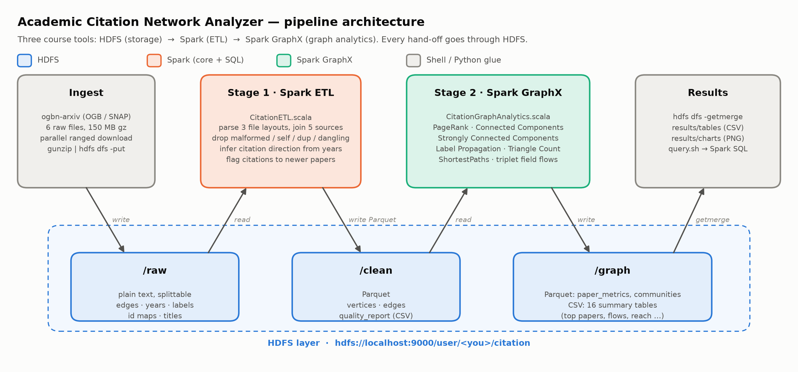

# Academic Citation Network Analyzer

**CSE412 Big Data & Large-Scale Computing: Applied Project (Track C: Graph Analytics)**

An end-to-end big-data pipeline that loads the **ogbn-arxiv** citation network (169,343 computer-science
papers and 1,166,243 citations) into **HDFS**. **Apache Spark** cleans and joins it, and **Spark GraphX**
runs graph algorithms to find which papers are most influential, how research fields cluster, and how far
ideas spread through the citation graph.



## Key results

| Question | Finding |
|---|---|
| Does PageRank agree with citation counts? | Overall yes (Spearman ρ = 0.93), but only 31 of the top 100 overlap. PageRank favours the foundational 2012–2014 deep-learning papers (dropout, R-CNN, DeCAF, Adam, VGG) |
| Can PageRank be trusted? | 34% of the top-1% PageRank papers get most of their rank from a single citing paper, because ogbn-arxiv truncates reference lists. Measured with GraphX `aggregateMessages`; derived lists use only well-supported papers |
| Do citation communities match real fields? | Label propagation vs arXiv subject labels: NMI 0.41 (random baseline 0.09), ARI 0.22 (0.00), purity 0.65 (0.21) |
| How inward-looking are fields? | 65.5% of citations stay in-field: cs.IT 88% and cs.CV 80%, but cs.AI only 39%. cs.CV ↔ cs.LG is the largest exchange (43 K citations each way) |
| Is the graph acyclic, as time would suggest? | No: 2,810 citation cycles covering 18% of papers, caused by arXiv revisions and late-dated classics |
| How far do top papers reach? | Each of the five most influential papers reaches 31–35% of all papers within 3 citation hops |

Full analysis: [docs/report.pdf](docs/report.pdf) (source: [docs/report.md](docs/report.md)).

## Tools and versions

| Tool | Version | Role in the pipeline |
|---|---|---|
| **HDFS** (Apache Hadoop) | 3.4.3 | Distributed storage for every stage: raw text in, Parquet between stages, results out |
| **Apache Spark** (core + SQL) | 4.0.4 (Scala 2.13.16) | Stage 1 ETL: parse, join, validate and orient the raw data; write Parquet |
| **Spark GraphX** | 4.0.4 | Stage 2: PageRank, connected components, SCC, label propagation, triangle count, shortest paths |
| Java (OpenJDK) | 21 | Runtime for Hadoop and Spark |
| scala-cli | 1.17+ | Builds the Spark application jar |
| Python 3 + matplotlib | 3.14 / 3.11 | Draws charts from the exported summary tables (no analysis) |

Data moves between the tools only through HDFS:
`HDFS /raw → Spark ETL → HDFS /clean (Parquet) → GraphX → HDFS /graph (Parquet + CSV) → results/`.

## Dataset

[ogbn-arxiv](https://ogb.stanford.edu/docs/nodeprop/#ogbn-arxiv) from the Open Graph Benchmark
(Microsoft Academic Graph subset): one vertex per arXiv CS paper (1971–2020) with its publication year
and one of 40 subject areas (cs.AI, cs.CV, cs.LG, …), and one directed edge per citation. Paper titles come
from the companion `titleabs.tsv` file keyed by MAG paper id.

| Raw file | Rows | Layout quirk the ETL handles |
|---|---|---|
| `edge.csv` | 1,166,243 | `a,b` pairs whose citation direction is not documented, so the ETL infers it from publication years |
| `node_year.csv`, `node-label.csv` | 169,343 each | No id column: line *i* belongs to paper *i* |
| `nodeidx2paperid.csv` | 169,343 | Header row; maps graph id → MAG id |
| `labelidx2arxivcategeory.csv` | 40 | Header row; `arxiv cs na` → normalised to `cs.NA` |
| `titleabs.tsv.gz` | 179,719 | Actually a gzipped **tar** archive; abstracts may contain tabs |

## Repository layout

```
run_pipeline.sh            one command: setup → download → HDFS → ETL → GraphX → results
conf/pipeline.env          versions, paths, HDFS layout, algorithm parameters
conf/log4j2.properties     quiet Spark logging for readable demo output
scripts/00_setup_tools.sh  downloads Spark 4.0.4 into ./tools (SHA-512 verified, no sudo)
scripts/01_download_data.sh  downloads ogbn-arxiv + titles (parallel ranged requests)
scripts/02_start_hadoop.sh starts HDFS, waits for safe mode to clear
scripts/03_ingest_hdfs.sh  stage 0: decompress and stream raw files into HDFS
scripts/04_build.sh        compiles the Scala application with scala-cli
scripts/05_run_etl.sh      stage 1: Spark ETL
scripts/06_run_graph.sh    stage 2: GraphX analytics
scripts/07_export_results.sh  copies summary tables out of HDFS and draws charts
scripts/query.sh           ad-hoc Spark SQL over the results in HDFS
spark-app/                 Scala source (CitationETL, CitationGraphAnalytics, QueryResults)
analysis/                  chart and architecture-diagram scripts
results/tables, charts     exported outputs (committed so the report is reproducible)
docs/                      proposal and report (.md source + .pdf), demo script, architecture diagram
docs/build_report.sh       renders the .md documents to PDF (python-markdown + LibreOffice)
```

## Prerequisites

- Linux or macOS with **Java 17+** (Java 21 tested). If `java -version` shows Java 8, set
  `CITATION_JAVA_HOME=/path/to/jdk-21` first. The scripts pin Java 21 by default.
- **Hadoop 3.x** with a working single-node HDFS (`fs.defaultFS` set in `core-site.xml`). `HADOOP_HOME`
  defaults to `~/hadoop`.
- **scala-cli** ([install](https://scala-cli.virtuslab.org/install)).
- **Python 3** with **matplotlib** (charts only).
- About 1.5 GB of free disk space and **3.5 GB of free RAM**. Spark runs with a 2 GB heap inside a
  systemd cgroup capped at 3.5 GB (`MEMORY_CAP_MB`), so a runaway job can only kill itself, never other
  applications. Scripts refuse to start Spark when less RAM than that is available. Measured peak: 2.6 GB.

Spark itself does **not** need to be installed: `scripts/00_setup_tools.sh` downloads it into `./tools`.

## Running it

```bash
./run_pipeline.sh            # everything, end to end (first run ≈ 25 min, mostly the throttled download; 5 min 41 s measured after that)
```

Or one stage at a time (useful for the demo):

```bash
./scripts/00_setup_tools.sh      # Spark into ./tools
./scripts/01_download_data.sh    # dataset into ./data/raw
./scripts/02_start_hadoop.sh     # HDFS up
./scripts/03_ingest_hdfs.sh      # raw files → HDFS /user/$USER/citation/raw
./scripts/04_build.sh            # Scala → spark-app/target/citation-analyzer.jar
./scripts/05_run_etl.sh          # Spark: /raw → /clean
./scripts/06_run_graph.sh        # GraphX: /clean → /graph
./scripts/07_export_results.sh   # /graph summaries → results/
```

Each step is idempotent, so re-running skips work that is already done. Use `FORCE=1 ./scripts/03_ingest_hdfs.sh`
to overwrite the raw files in HDFS.

### Querying the results

```bash
./scripts/query.sh "SELECT title, year, in_degree, pagerank_rank FROM papers
                    WHERE category = 'cs.CL' ORDER BY pagerank_rank LIMIT 10"
```

These views are available: `papers` (one row per paper with every metric), `communities` (one row per
label-propagation community) and `citations` (clean edges).

### Configuration

All knobs live in `conf/pipeline.env` and can be overridden from the environment, e.g.
`DRIVER_MEMORY=4g LPA_MAX_STEPS=20 ./scripts/06_run_graph.sh`.

| Variable | Default | Meaning |
|---|---|---|
| `SPARK_MASTER` | `local[4]` | Use `yarn` to submit to the YARN cluster (02 then also starts YARN) |
| `DRIVER_MEMORY` | `2g` | Spark driver heap |
| `MEMORY_CAP_MB` | `3584` | Hard memory ceiling for the whole Spark JVM (systemd cgroup) |
| `SPARK_SCRATCH` | `data/spark-scratch` | Shuffle/spill directory. Kept off `/tmp`, which is RAM-backed on many systems; emptied after every job |
| `PAGERANK_TOL` / `PAGERANK_RESET` | `1e-4` / `0.15` | Dynamic PageRank convergence tolerance and reset probability |
| `LPA_MAX_STEPS` | `10` | Label-propagation supersteps |
| `SCC_ITERS` | `10` | Strongly-connected-components outer iterations (`0` skips SCC) |
| `LANDMARKS` | `5` | Number of top-PageRank papers used as shortest-path landmarks |

## Outputs

| Location | Contents |
|---|---|
| HDFS `/clean/vertices`, `/clean/edges` | Clean Parquet graph (stage 1) |
| HDFS `/clean/quality_report` | Row counts dropped or flagged at every cleaning step |
| HDFS `/graph/paper_metrics` | Per-paper Parquet: degrees, PageRank and ranks, WCC, SCC, community, triangles, clustering |
| HDFS `/graph/communities` | Per-community Parquet: size, dominant field, purity, most influential paper |
| HDFS `/graph/summary/*` | Summary CSVs (top papers, hidden gems, field flows, …) |
| `results/tables/*.csv` | The same summaries copied locally |
| `results/charts/*.png` | Report charts |

## Troubleshooting

| Symptom | Fix |
|---|---|
| `UnsupportedClassVersionError` or Spark refuses to start | Java 8 is active. The scripts pin `/usr/lib/jvm/java-21-openjdk-amd64`; set `CITATION_JAVA_HOME` if yours is elsewhere |
| `HDFS is not reachable` | `./scripts/02_start_hadoop.sh`; check `jps` shows NameNode and DataNode |
| `Name node is in safe mode` | Wait, or `hdfs dfsadmin -safemode leave` |
| Download crawls at ~5 KB/s | snap.stanford.edu throttles each connection; the script already uses 32 parallel range requests (`DOWNLOAD_PARALLELISM`) and resumes if re-run |
| `Only N MB RAM available` | Close some applications, or lower `DRIVER_MEMORY` and `MEMORY_CAP_MB` together (cap must exceed heap by ≥ 768 MB) |
| Spark exits with code 137 | It hit `MEMORY_CAP_MB` and the cgroup stopped it (other apps are unaffected). Raise the cap if you have spare RAM, or skip SCC with `SCC_ITERS=0` |
| Spark job hangs with idle cores in local mode | Make sure `SPARK_LOCAL_IP=127.0.0.1` is set (`scripts/common.sh` does this). Otherwise HDFS-local tasks wait forever for a host with no executor |
| Rebuilding the docs | `./docs/build_report.sh` regenerates `docs/report.pdf` and `docs/proposal.pdf` (needs LibreOffice) |
