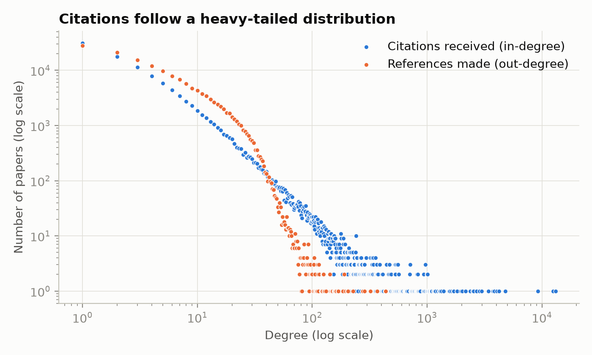
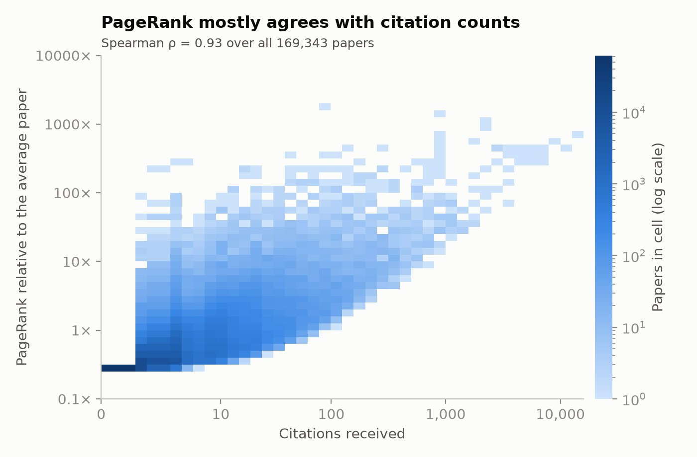
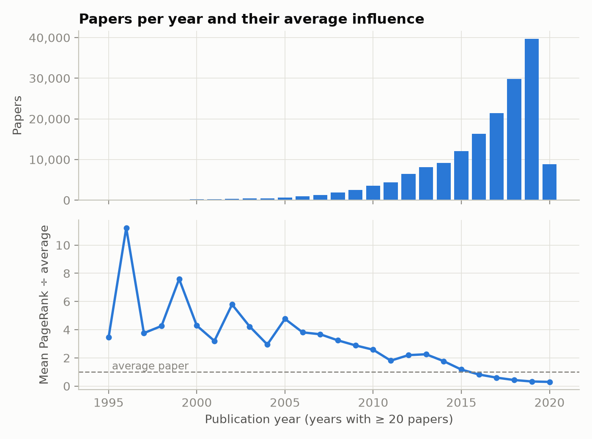
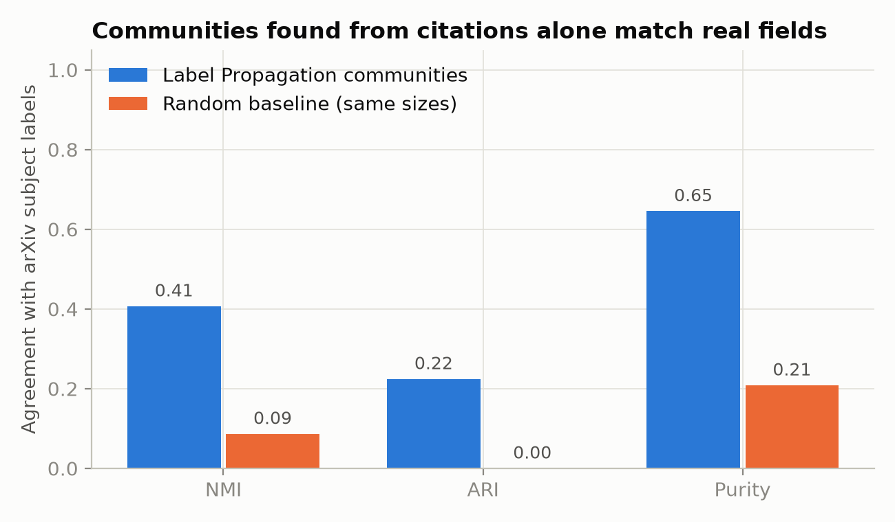
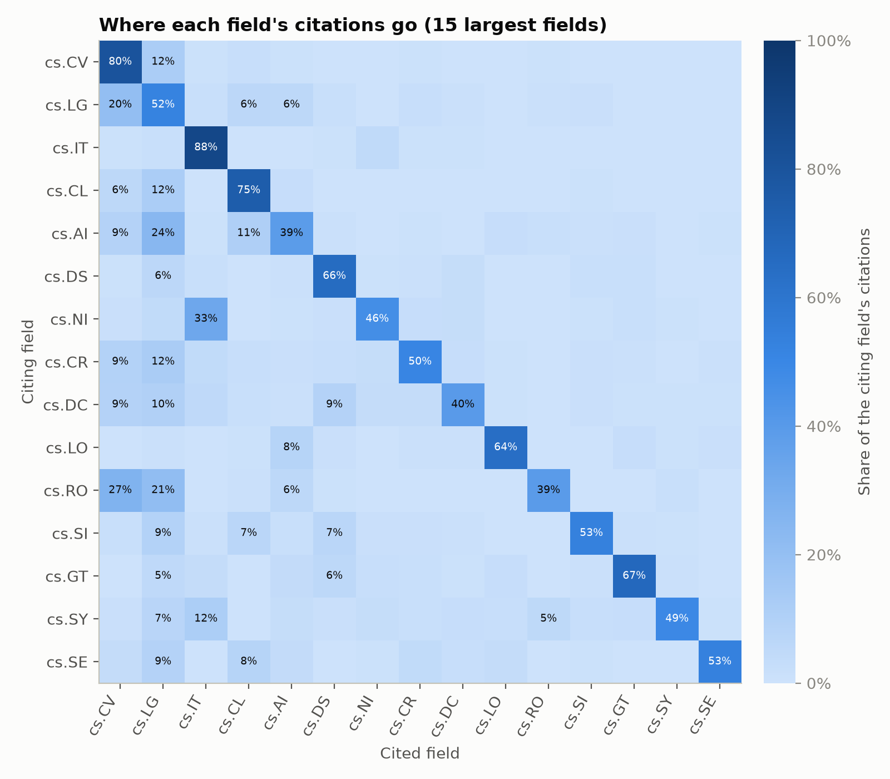
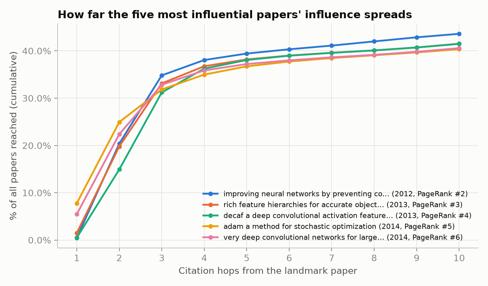

# Academic Citation Network Analyzer

**CSE412 Big Data & Large-Scale Computing: Applied Project Final Report** 
Track C (Graph Analytics): HDFS → Apache Spark → Spark GraphX 
Team: _Member 1_ · _Member 2_ · _Member 3_

---

## 1. Introduction

Citation counts are the usual proxy for a paper's importance, but they treat every citation as equal and
say nothing about how fields connect or how ideas spread. This project builds an end-to-end big-data
pipeline that analyses the **structure** of a citation network of 169,343 computer-science papers and
1,166,243 citations. It answers three questions:

1. **Influence:** Which papers are most influential when influence propagates through the network (PageRank),
   where does that disagree with raw citation counts, and how far can the result be trusted?
2. **Structure:** Do research communities discovered from citation links alone match the subject areas authors
   chose? How much do fields cite one another?
3. **Reach:** How many papers build on the most influential papers within one, two or three citation hops?

The pipeline uses three course tools in a genuine chain. **HDFS** stores every stage's input and output,
**Apache Spark** cleans and assembles the raw data, and **Spark GraphX** runs the graph algorithms.
Every hand-off between tools goes through HDFS.

## 2. Dataset

We use **ogbn-arxiv** from the Open Graph Benchmark (Stanford SNAP), a subset of the Microsoft Academic
Graph (MAG). The raw release consists of six files in four different layouts, so assembling a clean graph
is real ETL work rather than a single `read.csv`.

| Raw file | Rows | Content and quirks |
|---|---|---|
| `edge.csv` | 1,166,243 | `a,b` pairs. The documentation says "one paper cites another" but not which column cites |
| `node_year.csv` | 169,343 | Publication year. **No id column**: line *i* is paper *i* |
| `node-label.csv` | 169,343 | Subject-area index 0–39. Positional like the years file |
| `nodeidx2paperid.csv` | 169,343 | Header row; graph id → MAG paper id |
| `labelidx2arxivcategeory.csv` | 40 | Header row; `arxiv cs na` style names |
| `titleabs.tsv.gz` | 179,719 | MAG id, title, abstract. Despite the name, a **gzipped tar archive** |

Sizes: 150 MB compressed, **218 MB** uncompressed in HDFS. Papers span 1971–2020. The 40 subject areas
range from cs.CV (27,321 papers) to a long tail of fields with a few hundred papers each.

## 3. Architecture

*Figure 1. Compute stages (top) read from and write to HDFS (bottom); no stage passes data to the next
in memory or through local files.*

| HDFS path | Written by | Format | Read by |
|---|---|---|---|
| `/user/<you>/citation/raw/` | Stage 0 ingest (`hdfs dfs -put`) | Plain text, decompressed so it is splittable | Stage 1 |
| `/user/<you>/citation/clean/` | Stage 1 Spark ETL | Parquet (vertices, edges) + CSV quality report | Stage 2 |
| `/user/<you>/citation/graph/` | Stage 2 GraphX | Parquet (paper_metrics, communities) + 16 CSV summaries | Export, `query.sh` |

The whole pipeline runs with one command (`./run_pipeline.sh`). Each stage is also a separate,
idempotent script, so a stage can be re-run without repeating the earlier ones.

## 4. Tool-by-tool justification

**HDFS (Hadoop 3.4.3): storage and the hand-off between tools.** HDFS stores files in replicated blocks
that any number of Spark tasks can read in parallel, and it outlives every Spark session, so stages can
be re-run independently. We deliberately store the raw files *decompressed*: gzip is not splittable, so a
`.gz` file can only ever be read by one task, while the 200 MB title file stored as plain text spans two
HDFS blocks and is read by two tasks at once. HDFS also holds the GraphX checkpoints that make the
iterative algorithms fit in memory (Section 7).

**Apache Spark 4.0.4 (core + SQL): ETL.** The raw data needs joins across five sources, positional
files whose only key is the line number, a tar-wrapped TSV, and an empirical decision about edge
direction. Spark handles all of this in parallel: `zipWithIndex` recovers line numbers across HDFS
blocks, DataFrame joins assemble the vertex table, and `try_cast` turns malformed values into
countable nulls instead of job failures. Spark writes columnar Parquet, so the next stage reads only the
columns it needs.

**Spark GraphX 4.0.4: graph analytics.** Every question in Section 1 needs an iterative algorithm over
the whole graph: PageRank and shortest paths each run tens of supersteps over all 1.17 M edges
(the longest shortest-path chain is 32 hops), and label propagation runs 10. In SQL or MapReduce each superstep would be a separate self-join job that
re-reads the edge list. GraphX keeps the graph partitioned in memory (`EdgePartition2D`) and ships only
messages between supersteps through the Pregel API. It also provides the triplet view (each edge with
both endpoints' properties), which turns "how much does each field cite each other field" into one pass.

**Why one tool is not enough.** HDFS alone cannot compute anything. Spark SQL alone can clean the data
but cannot express Pregel-style iteration without dozens of hand-written self-joins. GraphX alone has no
storage layer and no convenient way to parse and join messy raw files. Each tool covers a gap the others
leave.

## 5. Implementation

### 5.1 Stage 0: ingestion into HDFS

`snap.stanford.edu` throttles each connection to about 6 KB/s, which would make the 150 MB download take
over 7 hours. `01_download_data.sh` splits each file into 1 MB HTTP range requests fetched over 32
parallel connections (~80 KB/s per 16 connections). It resumes interrupted downloads, and checks the
size and archive integrity of the result. `03_ingest_hdfs.sh` then streams each file into HDFS
(`gunzip -c … | hdfs dfs -put -`) without writing an uncompressed local copy. While inspecting the
titles file we found that it is a tar archive inside gzip. A plain `gunzip` leaves a 512-byte tar header
glued to the first record, so that file is unpacked with `tar -xzO`. `hdfs fsck` reports the six files as
HEALTHY in 7 blocks.

### 5.2 Stage 1: Spark ETL (`CitationETL.scala`)

1. Read `node_year` and `node_label` with `textFile(...).zipWithIndex()` to recover the paper id, and
   check that both files have the same number of lines.
2. Join years, labels, the MAG-id mapping, normalised category names (`arxiv cs na` → `cs.NA`) and titles
   (split on the first two tabs only; collapse whitespace; deduplicate by MAG id).
3. Validate vertices: year in 1900–current, known category, MAG id present.
4. Clean edges step by step, counting what each step removes: malformed lines, self-citations,
   duplicates, and dangling edges whose endpoint is not a clean vertex.
5. **Infer the citation direction from the data.** A citing paper is normally newer than the paper it
   cites, so we compare publication years on every edge and keep the orientation in which the source is
   newer.
6. Flag edges where a paper cites a *newer* paper, and count reciprocal pairs.
7. Write `vertices` and `edges` as Parquet, plus the quality report, to HDFS.

| Data-quality check | Result |
|---|---|
| Papers with year, category, MAG id and title after joins | **169,343 / 169,343** (0 dropped, 0 missing titles) |
| Malformed / self-citation / duplicate / dangling edges | 0 / 0 / 0 / 0 (checks ran; the OGB release is pre-cleaned) |
| Edges where source is newer / older / same year as target | **1,016,324 (87.1%)** / 20,903 (1.8%) / 129,016 (11.1%) |
| Direction decision | keep: `src` cites `dst` |
| Citations to a newer paper (flagged, kept) | 20,903 |
| Reciprocal pairs (A cites B and B cites A) | 8,444 |

The edge checks removing nothing is itself a finding: OGB already deduplicated the edge list. The real
value of the stage is the assembly of five sources, the recovery of positional ids, the tar-wrapped
titles, and the data-driven direction decision. Without that decision every PageRank score would flow
the wrong way.

### 5.3 Stage 2: GraphX analytics (`CitationGraphAnalytics.scala`)

The stage loads the Parquet tables into a `Graph[Paper, Int]` (vertex property: year and subject label)
partitioned with `EdgePartition2D`, then runs:

| Analysis | GraphX API | Purpose | Time |
|---|---|---|---|
| Degrees | `inDegrees`, `outDegrees` | Citation counts, reference counts | 1.5 s |
| PageRank | `pageRank(tol = 1e-4, reset = 0.15)` (Pregel) | Influence propagated through citations | 33.8 s |
| Rank support | `aggregateMessages` | Share of each paper's PageRank coming from its single largest citer | 0.5 s |
| Weakly connected components | `connectedComponents()` (Pregel) | Is the graph one connected body? | 5.1 s |
| Strongly connected components | DataFrame trimming + `stronglyConnectedComponents(10)` | Citation cycles | 112.3 s |
| Label propagation | `lib.LabelPropagation.run(g, 10)` (Pregel) | Communities from citations only | 54.4 s |
| Triangle count | `triangleCount()` | Local clustering | 7.8 s |
| Shortest paths | `lib.ShortestPaths.run(g, 5 landmarks)` (Pregel) | Reach of the top papers | 19.4 s |
| Field flows | `triplets` + `reduceByKey` | Field-to-field citation matrix | 0.4 s |

Every result is validated against something independent: PageRank against citation counts (Spearman
correlation, top-k overlap), communities against arXiv subject labels *and* a size-matched random
baseline, and clustering against a random graph of equal density. Outputs are a per-paper Parquet
table with every metric, a per-community table, and 16 summary CSVs. The summaries are exported to
`results/` and can be queried live with `scripts/query.sh` (Spark SQL over the HDFS Parquet).

## 6. Results

### 6.1 Degree structure

*Figure 2. Citations received and references made, both heavy-tailed.*

Citations are extremely concentrated. The mean paper is cited 6.9 times, the maximum 13,155 times (Adam),
and **36.6% of papers are never cited** within the dataset. 10.3% of papers have no references inside the
dataset, because ogbn-arxiv only keeps citations between arXiv CS papers. This truncation matters for
PageRank (Section 6.2).

### 6.2 Influence: PageRank vs. citation counts

*Figure 3. Every paper binned by citation count and PageRank. Darker means more papers.*

PageRank and citation counts agree strongly overall: **Spearman ρ = 0.93** across all 169,343 papers. At
the top they diverge sharply: only **31 of the top 100** papers by PageRank are also in the top 100 by
citations (366 of the top 1,000). PageRank rewards papers cited *by influential papers*. Its top 10 is the
foundation of the deep-learning era (dropout, R-CNN, DeCAF, Adam, VGG, ZFNet, OverFeat, GoogLeNet), while
the citation top 10 is weighted towards later, broadly used papers such as ResNet, BatchNorm and Faster R-CNN.

| PR rank | Paper (year) | Cited by | Citation rank | Largest-citer share |
|---|---|---|---|---|
| 1 | Deep, big, simple neural nets for handwritten digit recognition (2010) | 93 | 1,550 | **0.72** |
| 2 | Improving neural networks by preventing co-adaptation (dropout) (2012) | 808 | 84 | 0.32 |
| 3 | Rich feature hierarchies for accurate object detection (R-CNN) (2013) | 2,493 | 16 | 0.09 |
| 4 | DeCAF: a deep convolutional activation feature (2013) | 830 | 78 | 0.34 |
| 5 | Adam: a method for stochastic optimization (2014) | 13,155 | 1 | 0.06 |
| 6 | Very deep convolutional networks (VGG) (2014) | 9,244 | 3 | 0.03 |

**How far can PageRank be trusted here? A diagnostic we added.** The #1 paper has only 93 citations.
Querying its neighbourhood showed why: the dropout paper (#2) has **exactly one reference inside the
dataset**, and it is this paper. PageRank splits a paper's rank evenly over its references, so dropout
hands *all* of its very large rank to it. The cause is truncated reference lists (Section 6.1), not
genuine influence. To measure this across the whole graph we computed, with GraphX `aggregateMessages`,
the share of each paper's incoming rank supplied by its single largest citer. Among the top 1% by
PageRank (1,693 papers):

- **578 (34%)** receive more than half of their rank from one citing paper;
- 122 have five or fewer citations, and 118 of those get most of their rank from a single citer
  (mean share 0.85), typically through a chain of single-reference papers or a two-paper citation cycle;
- 1,095 (65%) are **well supported** (≥ 10 citations and no citer supplying more than half).

We therefore report raw PageRank but base the derived lists on well-supported papers. **Hidden gems**
are well-supported papers in the PageRank top 1% whose citation rank is far lower. Examples are
Kavukcuoglu, Ranzato & LeCun's *Fast inference in sparse coding algorithms* (PageRank #17, citation rank
3,612) and Turney's *Mining the web for synonyms: PMI-IR versus LSA* (#33 vs 2,453): foundational papers
cited by the field's key works.

*Figure 4. Papers per year (top) and their mean PageRank relative to the average paper (bottom).*

PageRank is strongly **time-biased**. Papers from 1995–2005 average roughly 3–11× the mean rank, while 2018–2020
papers average below 0.5×, because new papers have had little time to be cited. Rankings should be
compared within a cohort. The "rising stars" list (top PageRank among 2019–2020 papers) also exposed a
data issue: entries such as Rumelhart et al.'s *Learning internal representations* and Heckerman's
*Tutorial on learning with Bayesian networks* are decades-old classics dated 2019–2020 because
ogbn-arxiv records when a paper appeared on arXiv/MAG. Late-dated classics are also one source of the
20,903 "citations to newer papers" found in Stage 1.

### 6.3 Communities vs. research fields

Label propagation found 8,896 communities: 1,893 with at least 10 papers, and 61% of all papers in
communities of 100 or more. The largest, 27,938 papers (63% cs.CV, most influential paper: dropout), is
the deep-learning community. Others are a 10,996-paper speech/NLP community (56% cs.CL), a word-embedding
community (72% cs.CL, centred on word2vec), and several cs.IT communities for wireless and MIMO
(76–93% cs.IT).

*Figure 5. Agreement between label-propagation communities and arXiv subject labels, against a random
assignment with identical community sizes.*

Agreement with the authors' own subject labels is far above chance. **NMI 0.41 vs 0.09**,
**ARI 0.22 vs 0.00** and **purity 0.65 vs 0.21** for a random baseline with the same community sizes.
The baseline matters because NMI and purity rise with the number of clusters even for random labels.
The citation graph alone therefore recovers a substantial part of the field structure. It does not
recover all of it, because fields such as cs.LG and cs.AI genuinely overlap (Section 6.4).

### 6.4 How fields cite each other

*Figure 6. Row-normalised share of each field's citations going to each field (15 largest fields).*

Overall **65.5% of citations stay within the citing paper's field**, but this varies widely. cs.IT (88%),
cs.CV (80%) and cs.CL (75%) are inward-looking, while cs.AI (39%), cs.RO (39%) and cs.DC (40%) mostly cite
other fields. The largest cross-field flows run between cs.CV and cs.LG (43,395 and 43,394 citations, an
almost perfectly symmetric exchange), then cs.CL → cs.LG (14,386). Robotics draws 27% of its citations
from cs.CV and 21% from cs.LG, a sign of the field's shift to learned perception. Networking (cs.NI) takes
33% of its citations from information theory.

### 6.5 Connectivity, cycles and clustering

- **One weakly connected component** containing all 169,343 papers (OGB extracted the connected graph).
- **Citation cycles.** A citation graph ordered in time should have no cycles. We found **2,810 strongly
  connected components** larger than one paper, covering **30,930 papers (18%)**. The largest has 23,164
  papers, mainly cs.CV (6,158), cs.IT (5,011), cs.LG (3,744) and cs.CL (2,705), with median years
  2015–2017. Cycles come from arXiv revisions (a paper
  updated after publication cites later work that cites it), the 8,444 reciprocal pairs, and late-dated
  classics. They explain the long tails of the shortest-path runs (up to 32 hops) and are one source of
  the PageRank rank sinks above.
- **Clustering.** 2,233,524 triangles. Average clustering coefficient **0.226**, versus 8.1 × 10⁻⁵ for a
  random graph of the same density, about 2,800× higher. Papers that cite the same work tend to cite each
  other: strong local community structure, consistent with Section 6.3.

### 6.6 Reach of the most influential papers

*Figure 7. Cumulative share of all papers within k citation hops of the five most influential
well-supported papers.*

Influence spreads fast. Adam is cited directly by 7.8% of all papers, but within **three hops** each of
the five landmark papers reaches **31–35% of the entire dataset**: dropout reaches 58,958 papers (34.8%).
Growth then flattens: about 40–44% within 10 hops, and 55–57% eventually reach each landmark. The other
~44% sit in parts of computer science that never build on deep learning, such as information theory,
logic and parts of algorithms.

## 7. Performance and resource use

Hardware: one laptop (12 cores, 14 GB RAM shared with a desktop session), single-node HDFS.

| Stage | Wall time | Notes |
|---|---|---|
| Download (first run only) | ≈ 17 min | Throttled mirror, 32 parallel range requests |
| Ingest into HDFS | ≈ 1 min | 218 MB, 7 blocks |
| Stage 1 Spark ETL | ≈ 18 s | 169 K vertices, 1.17 M edges |
| Stage 2 GraphX | ≈ 4.5 min | Breakdown in Section 5.3 |
| Export + charts | ≈ 20 s | |
| **Whole pipeline** (`run_pipeline.sh`, data already downloaded) | **5 min 41 s** | Fresh HDFS; log in `results/pipeline_run.log` |

Spark runs as `local[4]` with a 2 GB heap inside a systemd cgroup capped at 3.5 GB. The measured peak
resident memory of the GraphX stage is **2.6–2.7 GB** across runs. The same jobs run unchanged on a YARN cluster with
`SPARK_MASTER=yarn`.

## 8. Challenges encountered

1. **Throttled dataset mirror** (~6 KB/s per connection). Solved with parallel HTTP range requests and
   resumable chunks; download time went from about 7 hours to about 17 minutes.
2. **A tar archive disguised as `.tsv.gz`.** Found by inspecting the first record; fixed with `tar -xzO`.
3. **Java versions.** The course shell exports Java 8, but Spark 4 requires Java 17 or later. The scripts
   pin Java 21 explicitly.
4. **Spark 4 ANSI mode** makes bad casts throw. We use `try_cast` so malformed rows are counted, not fatal.
5. **Driver memory exhausted by Pregel lineage.** The first GraphX run spent 247 s of 450 s in garbage
   collection, because each superstep extends the RDD lineage. Fixed by checkpointing to HDFS every
   5 supersteps (`spark.graphx.pregel.checkpointInterval`).
6. **A local-mode scheduler hang.** After enabling checkpoints, PageRank stopped with 11 tasks never
   launched. Checkpointed blocks prefer the HDFS DataNode host (`localhost`), but Spark had registered its
   executor under the Wi-Fi IP, so the scheduler waited for a "local" slot. Local mode has no periodic
   re-offer, so nothing ever woke it. Fixed with `SPARK_LOCAL_IP=127.0.0.1` and `spark.locality.wait=0`.
7. **GraphX's SCC exhausted the machine's RAM.** The built-in algorithm caches a new copy of the graph in
   each trimming round, and a near-acyclic graph needs many rounds. The kernel's out-of-memory killer
   terminated other desktop applications. We rewrote the trimming phase as DataFrame joins checkpointed to
   HDFS: 16 rounds cut the graph to a 44,097-vertex core. GraphX SCC then runs only on that core, with an
   identical result in 112 s. We also now run Spark under a cgroup memory cap, so an overrun can only kill
   Spark itself.
8. **`/tmp` is RAM-backed (tmpfs) on the test machine.** Spark's default shuffle directory there silently
   consumed about 0.8 GB of RAM and pushed the job over its cap. Scratch space now lives on disk and is
   deleted after each job.
9. **PageRank artifacts from truncated references** (Section 6.2). Diagnosed with a neighbourhood query,
   quantified with `aggregateMessages`, and handled with the well-supported filter.

## 9. Limitations and honest scoping

- **Scale.** 1.17 M edges fit on one laptop in under 5 minutes. The pipeline is distributed by
  construction (HDFS blocks, partitioned graph, no driver-side collection of large data), but we did not
  run it on a multi-node cluster. A target such as ogbn-papers100M (1.6 B edges) would need one.
- **Closed-world citations.** Only arXiv-CS → arXiv-CS citations exist in the data. Counts and PageRank
  measure influence *within this corpus*, not globally.
- **Dates** are arXiv/MAG dates, not original publication dates (Section 6.2).
- **Label propagation is a heuristic.** GraphX's synchronous version can oscillate, and its tie-breaking
  depends on partitioning. We ran a fixed 10 steps; results were identical across our runs with the same
  configuration, but other settings can produce different communities.
- **Single run per configuration.** We did not sweep PageRank's reset probability or the number of LPA steps.

## 10. Conclusion

The pipeline moves real data through HDFS → Spark → HDFS → GraphX → HDFS on a 1.17 M-edge citation graph
and produces results that hold up under validation. PageRank agrees with citation counts overall
(ρ = 0.93) but surfaces a different, earlier set of foundational papers at the top. About a third of
top-ranked papers owe their rank mainly to a single citer, an artifact we measured instead of hiding.
Communities found from citations alone match arXiv fields far above chance (NMI 0.41 vs 0.09). Fields
differ greatly in how inward-looking they are (cs.IT 88% vs cs.AI 39%). The landmark deep-learning papers
reach a third of all computer science within three citation hops.

## 11. Individual contributions

> **To be completed by the team.** The split below follows the pipeline stages and the demo script;
> edit it to reflect who actually did what.

| Member | Contribution |
|---|---|
| _Member 1_ | Hadoop/HDFS setup, download and ingestion scripts (Stage 0), architecture diagram, README, demo recording |
| _Member 2_ | Spark ETL (Stage 1): parsing, joins, direction inference, data-quality report; Spark SQL query tool |
| _Member 3_ | GraphX analytics (Stage 2): algorithms, validation metrics, rank-support diagnostic, charts and results analysis |
| All | Proposal, report writing, debugging (memory, scheduler hang), presentation |

## References

1. W. Hu et al. *Open Graph Benchmark: Datasets for Machine Learning on Graphs.* NeurIPS 2020. (ogbn-arxiv)
2. K. Wang et al. *Microsoft Academic Graph: When experts are not enough.* Quantitative Science Studies, 2020.
3. L. Page, S. Brin, R. Motwani, T. Winograd. *The PageRank Citation Ranking: Bringing Order to the Web.* Stanford InfoLab, 1999.
4. U. N. Raghavan, R. Albert, S. Kumara. *Near linear time algorithm to detect community structures in large-scale networks.* Phys. Rev. E 76, 2007. (label propagation)
5. G. Malewicz et al. *Pregel: A System for Large-Scale Graph Processing.* SIGMOD 2010.
6. J. E. Gonzalez et al. *GraphX: Graph Processing in a Distributed Dataflow Framework.* OSDI 2014.
7. Apache Spark 4.0.4 GraphX Programming Guide. https://spark.apache.org/docs/4.0.4/graphx-programming-guide.html
